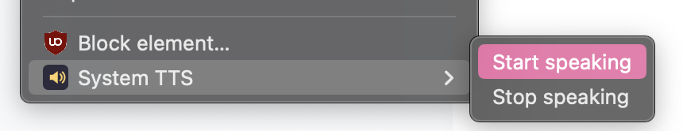
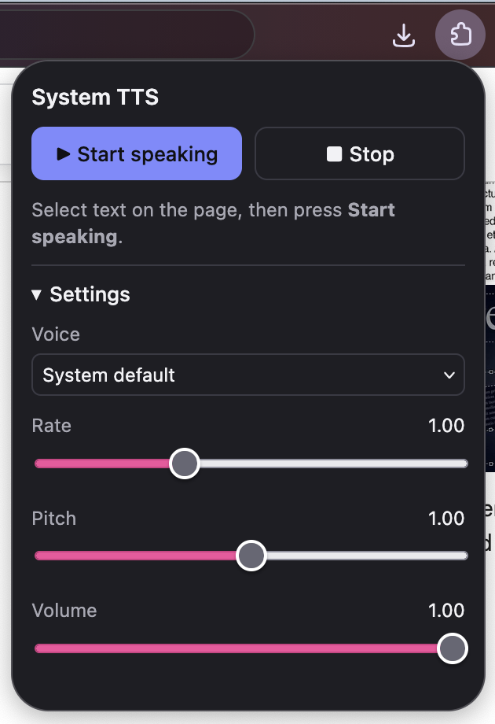

# Right-Click Context System TTS




A small Firefox extension that adds a native-feeling **"Start speaking"** /
**"Stop speaking"** action for selected text, using the operating system's
built-in text-to-speech voices (the same voices Chrome exposes via
*Speech → Start speaking* on macOS).

It adds the action in **two** places:

- **Right-click context menu** → a `System TTS` submenu containing
  *Start speaking* (shown only when text is selected) and *Stop speaking*.
- **Toolbar popup** (click the extension icon) → *Start speaking* / *Stop*
  buttons, plus voice / rate / pitch / volume settings.

## Files

```
manifest.json          Manifest V3 definition
background.js          Builds the context menu, relays clicks to the page
content/content.js     Speaks selected text with the Web Speech API
popup/popup.html       Toolbar popup markup
popup/popup.css        Toolbar popup styling
popup/popup.js         Toolbar popup logic + settings
icons/icon.svg         Toolbar / add-on icon
```

## How it works

The Web Speech API (`speechSynthesis`) maps to the platform's speech engine —
on macOS that is the system TTS, so the voices you already have are used.

Speaking is done in a **content script** injected into the page rather than in
the popup or background page. That matters because:

- the Manifest V3 background page can be unloaded at any time, and
- the popup is torn down as soon as it closes.

Running speech in the page's content-script context keeps it playing until it
finishes or is stopped.

## Install (temporary, for development)

1. Open Firefox and go to `about:debugging#/runtime/this-firefox`.
2. Click **Load Temporary Add-on…**.
3. Select `manifest.json` in this folder.
4. The icon appears in the toolbar. Temporary add-ons are removed when Firefox
   closes.

## Install (permanent, unsigned / self-signed)

Firefox release builds only install signed add-ons. For personal use you can:

- use Firefox **Developer Edition** or **Nightly** and set
  `xpinstall.signatures.required` to `false` in `about:config`, then install a
  zipped `.xpi` (zip the files with `manifest.json` at the root), **or**
- submit it to [addons.mozilla.org](https://addons.mozilla.org/developers/) for
  signing (self-distribution) and install the signed `.xpi`, **or**
- use `web-ext`:

  ```sh
  npx web-ext run          # launch a temporary Firefox with the extension
  npx web-ext build        # produce a distributable .zip/.xpi
  ```

## Usage

1. Select some text on a web page.
2. Either:
   - right-click → **System TTS** → **Start speaking**, or
   - click the toolbar icon → **Start speaking**.
3. To stop, use **System TTS** → **Stop speaking** in the context menu, or the
   **Stop** button in the popup.

The popup's settings (voice, rate, pitch, volume) are saved in the extension's
local storage and apply to both triggers.

## Notes / limitations

- Content scripts (and therefore the context-menu item) don't run on internal
  pages such as `about:` URLs, the Firefox PDF viewer, or addons.mozilla.org
  due to browser restrictions. Normal web pages work.
- The extension requests access to all sites purely so it can hear your
  selection on whatever page you're reading. It sends nothing anywhere;
  everything happens locally.
- The very first time a voice list is requested it may be empty for a moment
  while the browser loads the system voices. The popup waits for it and, if
  needed, asks the page for the list as a fallback.
